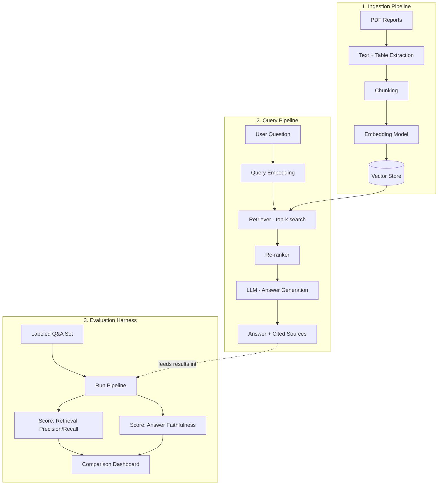

# Financial Report RAG System — Architecture

A Retrieval-Augmented Generation (RAG) system for answering questions over financial reports (10-K filings), with a built-in evaluation harness that measures retrieval and answer quality across different pipeline configurations.

## System Overview



## Components

### 1. Ingestion Pipeline
| Component | Purpose | Tools |
|---|---|---|
| PDF Loader | Extract raw text from filings | `unstructured`, `pdfplumber` |
| Table Extractor | Preserve table structure (rows/columns) as markdown or structured text | `camelot`, `unstructured` |
| Chunker | Split documents into retrievable units | Fixed-size, semantic, and structure-aware chunking (tested separately) |
| Embedder | Convert chunks into vectors | OpenAI `text-embedding-3-small` or `sentence-transformers` (local, free) |
| Vector Store | Store and index embeddings for similarity search | Chroma (local) or FAISS |

### 2. Query Pipeline
| Component | Purpose | Tools |
|---|---|---|
| Query Embedder | Convert user question into a vector | Same embedding model as ingestion |
| Retriever | Fetch top-k relevant chunks | Vector similarity search (+ optional hybrid keyword search) |
| Re-ranker | Re-score retrieved chunks for relevance | Cross-encoder (e.g., `ms-marco-MiniLM`) |
| Generator | Produce a grounded answer with citations | GPT-4o-mini / Claude / open-source LLM |

### 3. Evaluation Harness
| Component | Purpose |
|---|---|
| Labeled Q&A set | 30–50 questions with known correct answers and source pages, covering fact lookups, table-based questions, and multi-hop questions |
| Retrieval scorer | Checks whether the correct source chunk was actually retrieved (precision/recall) |
| Faithfulness scorer | Checks whether the generated answer is actually supported by retrieved context (LLM-as-judge or RAGAS) |
| Comparison dashboard | Table/chart comparing accuracy across different chunking strategies, embedding models, and re-ranker on/off |

## Data Flow (End-to-End)

1. **Ingest**: PDF reports → text/table extraction → chunking → embeddings → vector store.
2. **Query**: User asks a question → question embedded → top-k chunks retrieved → re-ranked → passed to LLM with the question → LLM generates answer with citations back to source chunks.
3. **Evaluate**: Same pipeline run against the labeled question set → results scored → logged into the comparison dashboard.

## Suggested Repository Structure

```
financial-rag-eval/
├── README.md
├── ARCHITECTURE.md
├── data/
│   ├── raw_pdfs/              # Source 10-K filings
│   └── eval_questions.csv     # Question, correct_answer, source_page
├── src/
│   ├── ingestion/
│   │   ├── extract.py         # PDF + table extraction
│   │   ├── chunk.py           # Chunking strategies
│   │   └── embed.py           # Embedding + vector store indexing
│   ├── retrieval/
│   │   ├── retriever.py
│   │   └── reranker.py
│   ├── generation/
│   │   └── generate.py        # Prompting + answer generation
│   └── evaluation/
│       ├── run_eval.py        # Runs eval_questions.csv through the pipeline
│       ├── metrics.py         # Precision/recall/faithfulness scoring
│       └── compare_configs.py # Runs multiple configs and logs results
├── results/
│   └── comparison_table.csv   # Output of compare_configs.py
├── dashboard/
│   └── app.py                 # Streamlit app to visualize results
├── requirements.txt
└── notebooks/
    └── exploration.ipynb
```

## Configurations to Compare (Core Experiment)

| Config | Chunking | Embedding | Re-ranker |
|---|---|---|---|
| Baseline | Fixed-size (500 tokens) | text-embedding-3-small | Off |
| V2 | Semantic chunking | text-embedding-3-small | Off |
| V3 | Semantic chunking | text-embedding-3-small | On |
| V4 | Table-aware chunking | text-embedding-3-small | On |

Each config is run against the same 30–50 labeled questions, and results are logged to `results/comparison_table.csv`.

## Tech Stack

- **Language**: Python
- **Orchestration**: LangChain or LlamaIndex
- **Vector Store**: Chroma (local, free)
- **Embeddings**: OpenAI `text-embedding-3-small` or `sentence-transformers`
- **LLM**: GPT-4o-mini or Claude Sonnet (via API)
- **Table Extraction**: `unstructured` / `camelot`
- **Evaluation**: Custom scorer + optionally RAGAS
- **Dashboard**: Streamlit

## Key Design Decisions to Document in README

- Why table-aware chunking was needed (naive chunking breaks numeric answers)
- Precision/recall tradeoffs observed between chunking strategies
- Where the re-ranker helped vs. added latency with minimal gain
- 2–3 concrete failure cases and root cause (retrieval miss vs. generation hallucination)
